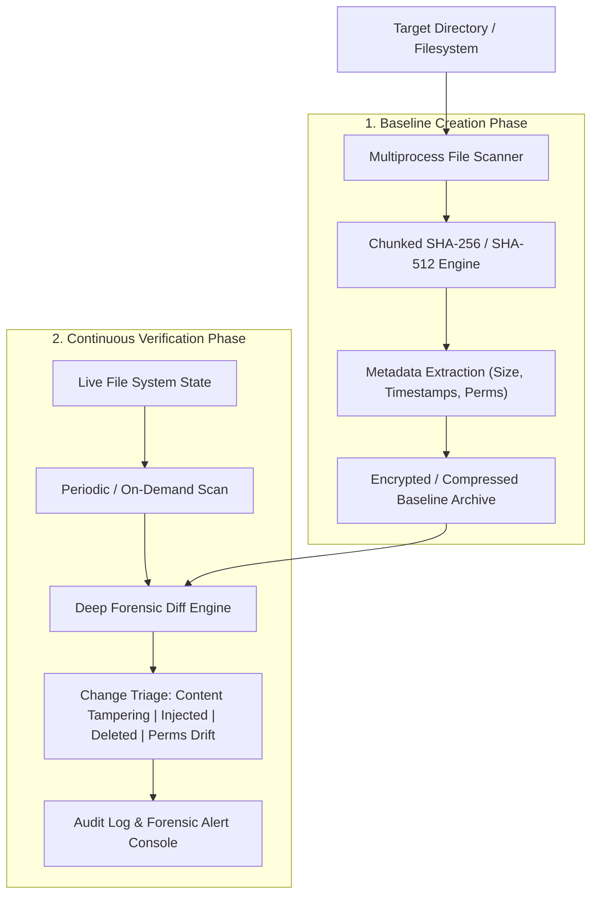

# File Integrity Checker & Baseline Forensic Monitor (FIC)

[](https://www.python.org/)
[](#)
[](#)
[](LICENSE)

An enterprise-ready, multi-threaded **File Integrity Monitoring (FIM)** and change-detection engine written in Python. It captures compressed cryptographic snapshots of system files and directories, tracking byte-level content tampering, unauthorized file additions, deletions, metadata shifts, and permission modifications.

---

## 📸 Output & Terminal Execution

<div align="center">
  
</div>

---

## 🛡️ Core Capabilities

- **🔐 Multi-Algorithm Cryptographic Hashing**: Computes SHA-256 (default), SHA-512, or MD5 checksums with chunked buffer streams for zero memory overhead.
- **⚡ Parallelized Multiprocessing Engine**: Uses worker pools to hash thousands of files simultaneously with real-time throughput metrics.
- **📦 Compressed Forensic Baselines**:
  - Serializes file paths, cryptographic hashes, size in bytes, inode/creation timestamps, and POSIX/Windows ACL permissions.
  - Generates tamper-resistant, version-controlled baseline snapshots.
- **🔍 Deep Forensic Diffing**:
  - **Modified Files**: Pinpoints altered content even if file modification timestamps were forged (anti-timestomping).
  - **New / Injected Files**: Instantly flags newly introduced executables, backdoors, or webshells.
  - **Deleted Files**: Reports vanished critical system libraries or configuration scripts.
  - **Metadata & Permission Drift**: Detects changes in read/write/execute attributes.
- **📊 Formatted Reporting**: Generates interactive CLI audit summaries with colored alerts and exported JSON records.

---

## 🏗️ System Workflow



---

## 📁 Repository Structure

```text
├── fic.py                           # Complete multi-threaded file integrity monitoring engine
├── Screenshot 2025-06-11 210440.png # Sample CLI baseline verification screenshot
└── README.md                        # Technical documentation
```

---

## 🚀 Installation & Quickstart

### 1. Prerequisites
- Python 3.9+ (Operates with zero external third-party dependencies — built on Python standard libraries `hashlib`, `multiprocessing`, `os`, `json`, `time`).

### 2. Clone the Repository
```bash
git clone https://github.com/JEFFERSON-007/FILE-INTEGRITY-CHECKER.git
cd FILE-INTEGRITY-CHECKER
```

### 3. Usage Examples

#### Step A: Generate a Known-Good Baseline
Create an initial snapshot of the directory you wish to protect:
```bash
python fic.py create-baseline --path /path/to/monitor --output baseline.json
```

#### Step B: Verify Integrity Against Baseline
Periodically check whether any file has been altered or tampered with:
```bash
python fic.py verify --path /path/to/monitor --baseline baseline.json
```

#### Sample Verification Output
```text
============================================================
              FILE INTEGRITY VERIFICATION REPORT
============================================================
[*] Target Directory  : C:\System32\Drivers
[*] Baseline Reference: baseline.json
[*] Scan Algorithm    : SHA-256
[*] Files Scanned     : 1,420 files in 1.14s (1,245 files/sec)

[!] TAMPERING DETECTED:
  [-] MODIFIED: C:\System32\Drivers\config.sys (Hash mismatch!)
  [+] INJECTED: C:\System32\Drivers\hidden_payload.exe (Untracked file)
  [x] DELETED : C:\System32\Drivers\security_policy.dll (Missing from disk)

[!] Overall Integrity Status: COMPROMISED (Action Required)
============================================================
```

---

## 👤 Author & Background
Developed by **[JEFFERSON RAJA A](https://github.com/JEFFERSON-007)**  
*Domain:* Cyber Security, System Forensics & Ethical Hacking  
*Internship:* CODTECH IT Solutions
